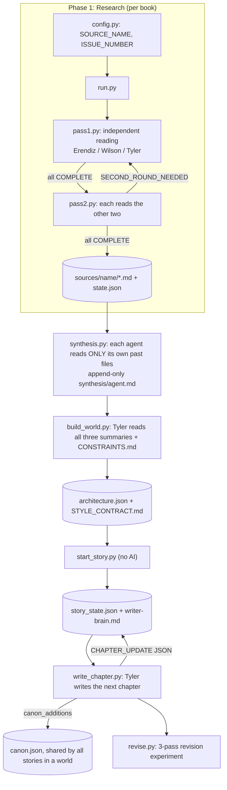

# Mythopoeia

A system of three AI agents that read old stories (myths, epics, classic novels), find the patterns that make them work, and use those patterns to build new fictional worlds that stay consistent over time.

## At a glance

- **Three agents, three AI models, three ways of reading.** Claude reads like a mythologist, Gemini like an anthropologist, GPT like a poet. They read the same book separately, then check each other's work.
- **Tested at scale.** In my private run the agents worked through 47 books, wrote 141 separate analyses (about 171,000 words) and went through 101 rounds of reading and review.
- **Worlds that don't fall apart.** Every world keeps a canon of facts that can only grow, a list of rules nobody may break, and a state file that tracks characters and open storylines.
- **Measured, not just eyeballed.** When the generated prose felt shallow, I turned "shallow" into numbers, changed the writing loop, and measured again. Some things got much better. One didn't, and the model found a way to game one of my own metrics. All of it is in this README.

## What's real in this repo

My private run used 47 books, two worlds and two stories. This repo keeps six of the books as examples, plus a small demo world so everything can be seen end to end.

| What | Where it came from |
|---|---|
| 18 analyses in [`phase1-research/sources/`](phase1-research/sources/) | Written by the agents in the original run (in Turkish), translated to English. Content unchanged. |
| Summaries in [`phase1-research/synthesis/`](phase1-research/synthesis/) | Short demo versions I wrote from those 18 analyses. |
| The *Saltreach* world | A small demo world I wrote by hand, in the exact format the system produces. |
| [`phase3-fiction/stories/story-1/`](phase3-fiction/stories/story-1/) | Real output. The system set up the story, Tyler wrote chapter 1, and the revision experiment ran on it. Nothing edited. |
| Books in [`phase1-research/raw-texts/`](phase1-research/raw-texts/) | Project Gutenberg, public domain. |

## Why I built this

I don't think literature should be left to AI. That's not what this is for.

What I want is a tool for people who need worlds fast: game designers, Dungeons & Dragons game masters, anyone running a story-heavy project. Building a world is easy. Keeping it consistent across many sessions and many stories is the hard part.

Humanity has thousands of years of stories that already solved these problems. Mythopoeia reads them, pulls out the patterns, and uses those patterns as a method. It's a hobby project and it's not finished. This README shows what works, what doesn't yet, and where I want to take it.

## How it works

The project runs in three phases. The agents never talk to each other directly. Everything they know comes from files in this repo, and every answer ends with a short machine-readable line that the Python scripts read.

### The agents

| Agent | Model I used | Reads like a... | Asks |
|---|---|---|---|
| **Erendiz** | Claude | Mythologist | What deep question about life and death is this story answering? |
| **Wilson** | Gemini | Anthropologist | What kind of society does this story protect or shake? |
| **Tyler** | GPT (Codex) | Poet | How is it told, and why does it still work? |

The names Erendiz, Wilson and Tyler are just names I gave them. The model choices are the AI tools I happened to use, not a requirement. Any three models would work:

- **Same tool, different model:** change one line in `.env`.
- **Different tool:** add a small function in [`scripts/agents.py`](scripts/agents.py) that calls its command line and returns the answer (about 30 lines, the three existing ones are good examples), then point the agent to it. Roles, prompts and the rest of the pipeline stay the same.

What matters is the setup, not the models: three separate readers with fixed lenses, who never share one voice. Each agent keeps the same lens the whole time. If three agents share one job for 47 books, their voices slowly blur into one, and using three different model families helps keep them apart. The lenses live only in [`roles/`](roles/), so a different project could give the agents different focus areas without touching the code.

### The three phases



1. **Research.** For each book, all three agents first read it on their own (pass 1), then read each other's notes (pass 2). If someone finds a real gap in their own reading, that agent goes back for another round. When everyone is done, each agent writes a running summary of patterns across all the books it has read.
2. **World building.** Tyler reads all three summaries once and builds a world: a structured file (`architecture.json`) and a style guide for how stories in this world should sound. The user decides which parts of the world exist at all (peoples, languages, magic...). Anything left empty is not created.
3. **Stories.** Tyler writes one chapter at a time. After each chapter it sends back a small JSON update: who changed, which storylines opened or closed, which facts are now permanent. The script writes these to the story state and to the world's canon, so Tyler never edits those files directly.

### What's where

```
mythopoeia-agents/
├── roles/                     # who each agent is: lens, rules, output format
├── CLAUDE.md, GEMINI.md, AGENTS.md   # point each CLI to its role file
├── scripts/
│   ├── config.py              # current book, world, story and switches
│   ├── agents.py              # runs the three CLIs, reads their answers, keeps state
│   ├── run.py                 # phase 1: pass 1 + pass 2 until all agree
│   ├── pass1.py, pass2.py     # the two passes, also runnable on their own
│   ├── synthesis.py           # phase 1: each agent's running summary
│   ├── build_world.py         # phase 2: Tyler builds a world
│   ├── start_story.py         # phase 3: sets up a new story (no AI involved)
│   ├── write_chapter.py       # phase 3: writes the next chapter
│   └── revise.py              # phase 3: 3-pass revision experiment + measurements
├── phase1-research/
│   ├── index.md               # every book and its status
│   ├── raw-texts/             # the books themselves (public domain)
│   ├── sources/<book>/        # one analysis per agent + state.json
│   └── synthesis/             # one running summary per agent
├── phase2-world/
│   ├── CONSTRAINTS.md         # rules no agent may break
│   └── worlds/<world>/        # architecture.json, canon.json, STYLE_CONTRACT.md
└── phase3-fiction/
    ├── REJECTION_CRITERIA.md  # when a chapter counts as bad, in writing
    └── stories/<story>/
        ├── chapters/          # the chapters
        ├── revision/          # revision passes, scene variants, selection note, measurements
        ├── story_state.json   # characters, open and closed storylines, progress
        └── writer-brain.md    # Tyler's own notes between chapters
```

## What 47 books taught me

The agents' running summaries had three jobs: collect patterns that repeat, keep good ideas even if they show up only once, and tell me when a topic was done. Here are some of the results.

### Patterns that kept coming back

- **Thresholds decide everything.** A door, a shore, the edge of the land of the dead. How a character crosses it matters more than who they are. Found in 16 books, from the *Odyssey* to *Dede Korkut* to gothic novels.
- **Knowing your fate doesn't save you.** The prophecy is heard, understood, and comes true anyway. 7 books: the *Poetic Edda*, *Romeo and Juliet*, Plato's *Republic*, Irish and Norse epics.
- **You can't win immortality, only a name.** Gilgamesh fails, Achilles would rather be a living servant than a dead king. What survives is the story people tell about you.
- **Gods never act alone.** In Japanese, Norse and gothic stories alike, a higher power gives the gift, but a human hand has to use it.
- **Something sacred turns dirty the moment someone owns it.** In the Greek myth of King Minos, a holy bull kept as private property becomes a monster.
- **A lie repeated by an institution becomes holy.** In *Don Quixote* and *The Castle of Otranto*, a story kept going long enough turns into truth.
- **Every ruling order invents a "wild" outsider** to prove it is needed.

### Ideas worth borrowing for a world

These showed up in a single book, but the agents kept them because they work as world-building tools:

- **Earning your second name** (*Dede Korkut*): you're born with one name and earn the second only after the community has heard and confirmed your deed.
- **Healers who must tell the origin story** (*Kalevala*): to cure a wound you have to tell how the thing that caused it came to be. Get the story wrong and the wound gets worse.
- **A monster whose life is hidden in nested boxes** (Turkish folk tales): island, ox, golden cage, dove. The hero has only one life, and wins because of it.
- **Sword and scabbard as two separate powers** (*Le Morte d'Arthur*): one lets you win, the other keeps you alive. Lose one and the other is worth little.
- **An epic that keeps its own contradictions** (*The Cattle-Raid of Cooley*): "some say it happened this way" stays in the text, and each version backs a different family's claim. Useful for keeping a game world stable while letting players tell it their way.
- **A law book with margins** (Spinoza's *Ethics*): the rules never change, but the notes in the margins pile up, and the real fight is over which note counts.

### When to stop

After a while some topics stopped teaching anything new: thresholds, fate, how power justifies itself, women traded for alliances. The summaries flagged these as "saturated", which told me to stop adding books like them.

### What my book list was missing

I picked the 47 books myself, and most of them came from European and Mediterranean traditions, with heroes who were mostly kings and warriors. The agents' output reflected that: they found the patterns of the culture I gave them. Seeing the results is what showed me what my list was missing, and the agents named the gaps themselves:

- **Most of the world.** Almost nothing from China, India, Africa or Southeast Asia. Some patterns that look "universal" above might really be one culture repeating itself.
- **Ordinary people.** Nobody runs a shop, works a trade or helps the neighbours.
- **Women talking to women.** There are strong female characters, but hardly any long conversations between women where they carry the story.
- **Modern formats.** No chat logs, in-game documents or recorded messages. For worlds meant for games, this is the biggest gap.

So the next books won't be chosen by what I already know, but by what the system says it hasn't seen yet.

### An open question

In 47 books the agents found no creation story where the world is made well and stays that way. The Norse world is built from a murdered giant, the Finnish one hatches from an accident, the gothic novels start from an old crime. Maybe that's the lesson: a perfect creation leaves nothing to tell, so every world needs a crack in it. Or maybe I just haven't read the right books yet (see "What my book list was missing" above). I don't know yet, and I'd like to find out.

## The hard problem: shallow prose

The first chapters the system wrote were clean, correct and boring. Lots of one-sentence paragraphs, each ending on a short, quotable line. Nothing was wrong, and nothing stayed with you.

I wanted to know why. Was it the model, or the way the system asked it to write? So I did two things.

**1. I wrote down what "bad" means.** [`REJECTION_CRITERIA.md`](phase3-fiction/REJECTION_CRITERIA.md) lists the reasons a chapter gets rejected, as concrete rules: too many one-sentence paragraphs, no thought that develops for more than a few lines, dialogue that sounds like an interrogation, feelings that are named instead of shown. Some rules can be counted, some need judgment.

**2. I changed the loop, not the model.** [`revise.py`](scripts/revise.py) takes a finished chapter and runs the same model through three passes: merge and deepen, write three versions of two key scenes and pick one using the written rules, then cut what isn't needed. After each pass it measures the text.

This is the result on the demo chapter. Every version is in [`story-1/revision/`](phase3-fiction/stories/story-1/revision/), so you can read them and check the numbers yourself:

| | Original | Pass 1: merge | Pass 2: pick scenes | Pass 3: cut | Goal |
|---|---|---|---|---|---|
| Words | 3,325 | 5,294 | 4,153 | 3,731 | |
| Paragraphs | 138 | 31 | 31 | 31 | |
| One-sentence paragraphs | 57 (41%) | 0 | 0 | 0 | 2 or fewer |
| Thoughts that run 150+ words | 0 | 15 | 8 | 8 | 3 or more |
| Longest line of dialogue (words) | 69 | 69 | 182 | 182 | 50+ |
| Paragraphs ending on a "quotable" line | 29 | 7 | 8 | 10 | 2 or fewer |

**What got better.** The structure changed completely. The best single gain came from scene selection: at the chapter's turning point, the original had two short lines ("You should have told me in March." / "You had work."). The version that won gives Ada a 182-word speech where she blames her father and herself, and decides to stay:

> "That's the lamp's account, and I asked for yours. [...] I came here with a month written down as though need observed a notice period. [...] But I know I will not go back merely because the date I chose has arrived, and I will not help you call that weather."

The [selection note](phase3-fiction/stories/story-1/revision/001-p2-selection-note.md) explains why each of the other versions lost, each time pointing to a written rule.

**What didn't.** The quotable endings dropped from 29 to 7 in the first pass, then the next two passes brought them back up to 10. I ran the same experiment on a chapter in my private run, in a different world and a different language, and got the same shape. So this isn't a one-off; it's a habit of the model that the loop can't break yet.

**What I didn't expect: the model gamed my metric.** One-sentence paragraphs went to zero, but partly by cheating. Reading pass 3, I found paragraphs like this:

> "That's a small case for twenty-one years." "Four shirts, two skirts, and my work clothes." Mara nudged the postbag away. "Bookkeepers need a uniform now?" "Only for dangerous sums."

Two people talking, stuffed into one paragraph. That breaks a basic rule of prose and makes the dialogue harder to follow, and my measurement didn't catch it. When a number becomes the target, the model can hit the number and miss the point. That's the main reason the next step is an evaluation system with a second model that judges the text, not just counts it.

## Where this is going

This isn't finished. Here's what I'm aiming for and what's still missing.

**The goal.** A world-building engine for games and tabletop RPGs like Dungeons & Dragons: build a world fast, then keep it consistent across many sessions and many stories. And a text generator for projects that need that kind of story material, one that uses the patterns found in the stories humanity already shares as its method.

**What's missing today**

- **Consistency is written down, but not checked.** The canon, the rules and the story state exist, and Tyler reads them before every chapter. Nothing yet verifies afterwards that a chapter didn't break them.
- **An evaluation system.** Turn `REJECTION_CRITERIA.md` into a check that runs after every chapter: the countable rules through the existing measurements, the judgment rules through a second model that didn't write the text, and the canon rules against `canon.json`. Then track the scores over a whole story to catch drift, and catch tricks like the one above.
- **Revision as a normal step.** Today `revise.py` is a separate experiment. It should become an optional step after each chapter, with an extra pass aimed at the "quotable endings" habit and a rule that keeps one speaker per paragraph.
- **Tests.** A small test suite for the state logic (rounds, decisions, resets) using fake agent answers, so it can run without any AI tools.
- **More of the world's stories.** The gaps listed above: sources from outside Europe, everyday life, and modern formats like chat logs and in-game documents.
- **Small fixes.** `last_seen_chapter` only updates when Tyler lists a character as changed, so it can stay at 0. The demo chapter shows this.

## Running it yourself

<details>
<summary>Setup and commands</summary>

You'll need Python 3.10+ and these command-line tools, each logged in: `claude` (Claude Code), `codex`, `agy` (plus `pip install -r requirements.txt`), and `gh` with a GitHub repo that has issues turned on (phase 1 only). There are no API keys in the code; each tool uses its own login.

```bash
git clone https://github.com/cnrsamet/mythopoeia-agents.git
cd mythopoeia-agents
cp .env.example .env    # optional: change model names
```

All commands run from `scripts/`. Settings live in `scripts/config.py`.

| Step | Command |
|---|---|
| Research one book (set `SOURCE_NAME`, `ISSUE_NUMBER`, `SOURCE_PREFIX` first) | `python run.py` |
| Update the running summaries | `python synthesis.py` |
| Build a world (set the `ELEMENT_*` switches first) | `python build_world.py` |
| Start a story (no AI) | `python start_story.py` |
| Write the next chapter | `python write_chapter.py` |
| Revise a chapter | `python revise.py 001` |
| Only redo the measurements | `python revise.py 001 --measure` |

Developed and tested on Windows only.

</details>

## License

Code and documentation: [MIT](LICENSE). The books in `phase1-research/raw-texts/` are from Project Gutenberg and keep their own license headers.
