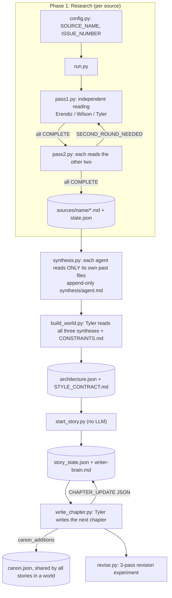

# Mythopoeia

Mythopoeia is a multi-agent pipeline that reads source texts (myths, epics, novels), builds an original fictional world from what it learned, and then writes fiction in that world. Three CLI coding agents from three model families each read every source through a fixed lens; one of them then becomes the only author. Python scripts handle orchestration and state, and all context is passed through files in this repo.

> This is a cleaned public copy of a private working repo. It keeps the full pipeline code, the agent role files and six public-domain sources as examples. Read [What is real in this repo](#what-is-real-in-this-repo) before using the sample outputs.

## Architecture

### Agents

| Agent | Model (default, set in `.env`) | CLI | Phase 1 lens | Phase 2/3 role |
|---|---|---|---|---|
| **Erendiz** | Claude (`claude-sonnet-5`) | `claude` | Mythologist / Cosmologist: what metaphysical tension does the text answer? | None. Its work ends with its synthesis file. |
| **Wilson** | Gemini (`Gemini 3.1 Pro (High)`) | `agy` via `agy-headless-bridge` | Anthropologist / Sociologist: what social order does the text hold up or shake? | None. Its work ends with its synthesis file. |
| **Tyler** | GPT (`gpt-5.6-sol`, high reasoning) | `codex exec` | Poet / Narrator: how is it told, and which technique makes it last? | **Only active agent.** Builds the world and writes the fiction. |

Role definitions are in [`roles/`](roles/). `CLAUDE.md`, `GEMINI.md` and `AGENTS.md` point each CLI to its own role file.

**Why three agents.** The goal is to extract the essence of a literary work from several distinct points of view at once. Each agent reads the same text with a different focus, and the three readings stay separate. The lenses are not fixed to the system: they are defined only in `roles/*.md`, so a different project can give the three agents different focus areas without touching the code.

**Why three model families.** The roles are split by *lens*, not by task. All three agents do the same job (read a source and analyze it) from a different angle. Using three different model families keeps the three readings from converging into one "committee voice" over many sources. The voices are never merged into one file. Tyler reads the other two syntheses only once, when a world is built.

**Why Tyler writes.** The author has to run for a long time, write many files and follow a growing set of rules. Tyler runs through `codex exec` in a sandboxed workspace (`--sandbox workspace-write`) and was the narrative lens from the start, so it carries that lens into writing.

### Pipeline



### How context moves between agents

The agents never call each other. Everything goes through files and a small set of machine-readable lines:

- **Task prompts** are built by the scripts for each call. They name the role file, the exact files to read and write, and the format of the answer.
- **Decision blocks.** Every agent ends its answer with `DECISION: COMPLETE`, `DECISION: SECOND_ROUND_NEEDED` + `REASON: ...`, or `DECISION: ENRICHMENT` in pass 2. `agents.py` parses these with regex and writes them to `state.json`.
- **Per-source state** (`phase1-research/sources/{source}/state.json`) records status, round and pass-2 status per agent. Rounds are asymmetric: an agent that finished is skipped, an agent that asked for a second round runs again with its own `REASON` fed back into the prompt. If any agent finishes a later round, everyone's pass-2 status is reset, so nobody keeps an approval based on a file that has since changed.
- **GitHub issues** are the discussion log of Phase 1. Agents post their notices and pass-2 reactions with `gh issue comment`, each signed `-Erendiz` / `-Wilson` / `-Tyler`, since all comments come from one account.
- **Synthesis** is append-only. `synthesis-state.json` tracks which sources each agent has already folded in, so each run only processes new ones (delta). Old rounds are never rewritten.
- **World and story state.** `architecture.json` (world + story skeleton), `canon.json` (append-only permanent facts shared by all stories in a world), `story_state.json` (characters, open/closed threads, progress) and `writer-brain.md` (Tyler's free-form, append-only notebook). After each chapter, Tyler returns a `CHAPTER_UPDATE` JSON block. The script applies it to `story_state.json` and `canon.json`, so Tyler never edits state files directly.

## Setup

Requirements:

- Python 3.10+
- The `claude` CLI (Claude Code), logged in
- The `codex` CLI, logged in
- The `agy` CLI, logged in, plus `pip install -r requirements.txt` (for `agy-headless-bridge`)
- The `gh` CLI, logged in, and a GitHub repo with issues enabled (only for Phase 1)

There are no API keys in the code. Each CLI uses its own login.

```bash
git clone https://github.com/cnrsamet/mythopoeia-agents.git
cd mythopoeia-agents
cp .env.example .env    # optional: change model names or the repo path
```

`MYTHOPOEIA_REPO_PATH` defaults to the repo root. Project settings (current source, world, story, element switches) live in `scripts/config.py`.

## Running

All commands run from `scripts/`.

**Phase 1, one source:**
1. Put the primary text in `phase1-research/raw-texts/{prefix}.txt` (optional; without it, agents search the web).
2. Open a GitHub issue for the source.
3. Set `SOURCE_NAME`, `CATEGORY`, `ISSUE_NUMBER` and `SOURCE_PREFIX` in `config.py`.
4. `python run.py`. This runs pass 1 and pass 2, repeating up to 6 loops until all three agents agree. `pass1.py` and `pass2.py` can also be run on their own.

**Synthesis:** `python synthesis.py`. Run it again until every agent is up to date.

**Phase 2, a world:** set `PREFERRED_GENRE`, `COMPLEXITY_PREFERENCE` and the `ELEMENT_*` switches in `config.py`, then `python build_world.py`. Elements left empty are inactive and are not generated at all. The script stops for human review and does not start Phase 3 on its own.

**Phase 3, a story:**
```bash
python start_story.py           # deterministic, no LLM: creates story-N from architecture.json
python write_chapter.py         # one chapter per run
python revise.py 001            # 3-pass revision experiment on chapter 001
python revise.py 001 --measure  # only rebuild the measurement table
```

## Sample output

### What is real in this repo

| Content | Where it came from |
|---|---|
| 18 Phase 1 analyses (`phase1-research/sources/`) and their `state.json` | Produced by the pipeline in the private repo, in Turkish. **Translated to English** for this repo; content and structure unchanged. |
| Synthesis files (`phase1-research/synthesis/`) | **Hand-written demo**, condensed from the six English analyses. The private synthesis covered 48 sources, including copyrighted ones, so it is not included. |
| Demo world *Saltreach* (`phase2-world/worlds/Saltreach/`) | **Hand-written seed** in the exact format `build_world.py` produces, so Phase 3 can run without the private worlds. |
| `phase3-fiction/stories/story-1/` | **Real pipeline output.** `start_story.py` created the story; `write_chapter.py` (Tyler/codex) wrote chapter 1, its writer-brain entry, the state update and the canon entries in one run. Not edited. |
| Raw texts (`phase1-research/raw-texts/`) | Project Gutenberg editions, public domain. |

### Phase 1: one source, three lenses

The same moment in the *Odyssey* (the bed built on a living olive tree), read by three agents in independent passes:

> **Erendiz:** "Odysseus is the best liar in the whole poem; so a story/word can never be the final proof. The final proof is *an object rooted in the earth that cannot be carried away*. The ground of identity is not the word, it is the trunk."

> **Tyler:** "Penelope's test of the bed asks for knowledge of how it was made that belongs only to the husband... So identity is not announced as 'believe this face'; it is built by an object, a body and a shared memory confirming each other."

> **Wilson** (pass 2, after reading Erendiz): "That the conflict can only be stopped by an intervention imposed from above reveals the dead end of blood-tie politics between households."

### Phase 3: one chapter in the demo world

From [`chapters/001.md`](phase3-fiction/stories/story-1/chapters/001.md), where Ada's father finally admits how bad his hands are. Note the Style Contract rule at work: a character speaks several sentences without interruption.

> "Since March," he said. "Worse since August. The right is better in the morning. The left is no use for fine work. I can fill the oil reservoir and wind the lens weight, but I can't always get the char even. An uneven wick smokes, the chimney clouds, and the light loses distance. There. That's the account."
>
> It was six sentences, Ada noted, and more than he had written her on the subject in seven months.

After the chapter, Tyler returned a `CHAPTER_UPDATE` block and the script applied it. `story_state.json` now tracks four open threads, for example:

```json
{ "thread": "Ada has noticed the old logbook covering the year the Wren sank.", "weight": "main", "opened_chapter": 1 }
```

and three permanent facts were appended to the world's `canon.json`. Tyler also left a planning note for itself in [`writer-brain.md`](phase3-fiction/stories/story-1/writer-brain.md) ("Avoid explaining either gesture too early").

## Design decisions and challenges

**Lens-based roles and voice separation.** Function-based roles ("researcher", "writer", "critic") tend to blur into one voice over a long run. Here, each agent keeps one lens for the whole of Phase 1, and the three voices meet exactly once: when Tyler reads all three syntheses to build a world.

**Independent pass first, shared pass second.** In pass 1, agents are told not to look at each other's files. In pass 2 there are only three outcomes: a real gap reopens pass 1, a valuable link is appended as a short `## Pass 2 Note`, or the agent approves. Agents may not rewrite their files after reading the others, so the independent reading is kept.

**Machine-readable endings.** The whole state machine depends on agents ending with a decision block, not a friendly closing line. The prompts say plainly that a missing `DECISION` line means the same task comes back next time. Unclear results are stored as `unclear` instead of being guessed.

**Safety rails for unattended agents.** `run.py` stops after 6 loops and asks for a human, because a loop that does not end usually means a real disagreement. Claude runs with an explicit tool allowlist and a denylist (`rm`, `curl`, `git push`, `sudo`...). Agents cannot delete files, so temp files must start with `.tmp_` and the scripts clean them up. `revise.py` re-checks the source chapter after every pass and writes it back if an agent changed it.

**The user keeps control of scope.** Left alone, a world-building agent tends to add peoples, languages and magic "just in case". In `build_world.py`, every world element is **inactive unless the user fills it in**, and inactive fields must be absent from the JSON, not empty. The target chapter count is also set by the user, because models tend to suggest much shorter stories than intended. `CONSTRAINTS.md` holds binding negative rules ("this must not happen") that come before the agent's own choices.

**Lessons from reading the output.** The seven base rules in every Style Contract (quotation marks, at least one long uninterrupted line of dialogue per chapter, varied warmth, a hook for every new term, and so on) came from earlier reader tests, where readers listed what made chapters hard to follow. They are written into the world-building prompt so every new world inherits them.

**Shallow prose and the revision experiment.** Chapters written in a single pass were clean but shallow: many one-sentence paragraphs, each closing on a short quotable line. The open question was whether the cause was the model or the loop. `revise.py` keeps the same model (Tyler) and changes only the loop: condense, generate three variants of two key scenes and select by written criteria (`REJECTION_CRITERIA.md`), then prune. A measurement table compares the versions. On one chapter in the private repo, the measured structure changed a lot:

| Metric | Original | After 3 passes | Target |
|---|---|---|---|
| Paragraphs | 109 | 26 | |
| Single-sentence paragraphs | 52 | 2 | at most 2 |
| Unbroken developments of 150+ words | 0 | 5 | at least 3 |
| Longest single line of dialogue (words) | 11 | 114 | 50+ |
| Aphorism-like paragraph endings | 28 | 9 | at most 2 |

The last row is the honest part: the condensing pass brought aphorism endings to 0, but the variant and pruning passes brought them back up. The loop fixed structure much better than it fixed this habit.

The demo chapter in this repo shows the same single-pass pattern in a new world and in English: 138 paragraphs, 41% of them single sentences, no unbroken development of 150+ words, 29 aphorism-like endings (from `revise.py`'s `measure()`). It reads cleanly, and by the written criteria it would still be rejected. The revision loop has not been run on it.

**Known limits.**
- `last_seen_chapter` is only updated when Tyler lists a character in `character_updates`, so it can stay at 0. The demo chapter shows this: all three characters appear, but the field is still 0.
- The text metrics in `revise.py` are simple heuristics (paragraph splits, sentence regex, a word-count proxy for aphorisms). They show trends; they are not a quality score.
- The scripts were developed and run on Windows; other platforms are not tested.
- There are no automated tests.

## Roadmap

- **Evaluation system.** Turn `REJECTION_CRITERIA.md` into an automated check after every chapter: the measurable A rules from the existing `measure()` function, the judgment-based B rules from an LLM judge outside the writing model, and C rules (canon, constraints, unintroduced terms) checked against `canon.json` and `architecture.json`. Track the scores across chapters to catch drift.
- Make the revision loop an optional step of `write_chapter.py` instead of a separate experiment, and add a pass aimed at aphorism endings.
- A small test suite for the state machine (round logic, pass-2 reset, decision parsing, index updates) using fake agent outputs.
- Fix `last_seen_chapter` by detecting character names in the chapter text.
- Make the output language a setting (the original runs wrote Turkish).

## License

Code and documentation: [MIT](LICENSE). The texts in `phase1-research/raw-texts/` are Project Gutenberg editions and keep their own license headers.
